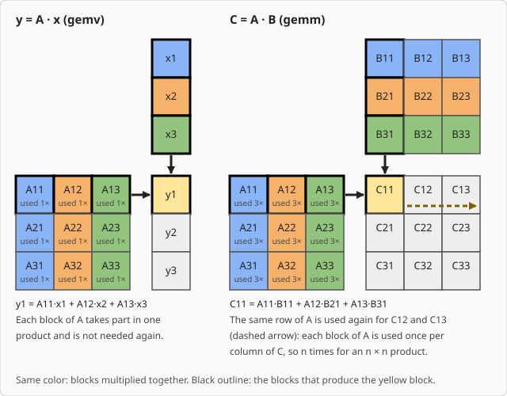
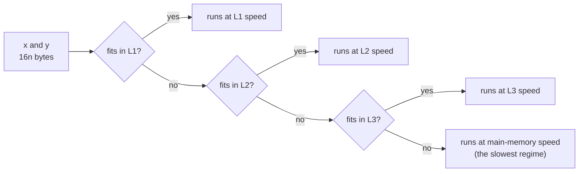

# Vectors and Matrix–Vector Products

[How a Fast BLAS Works](how_it_works.md) explains how matrix multiplication (`gemm`) is made fast by
cutting the matrices into blocks that stay in the cache. Blocking works because `gemm` uses every number
many times. The simpler routines, which work on vectors or on one matrix and one vector, do not, and
this page explains what that changes.

BLAS groups its routines into three *levels*:

| Level | Operates on | Examples |
|---|---|---|
| 1 | vectors | `axpy!` (`y += a·x`), `dot`, `nrm2`, `scal!`, `iamax` |
| 2 | one matrix, one or two vectors | `gemv!` (`y = A·x`), `ger!`, `symv!`, `trsv!` |
| 3 | matrices | `gemm!`, `syrk!`, `trsm!` |

## How many times is each number used?

The deciding question is how many times the routine needs each number it reads.

The figure cuts each matrix into 3 × 3 blocks and `x` and `y` into three blocks each. Blocks of the same
color are multiplied together: a column of `A` pairs with the matching block of `x` (or row of `B`). To
compute the yellow block, the blocks with a black outline are multiplied pairwise and added up. The
arrows show the row of `A` and the column of `x` (or `B`) meeting at the result.

In `y = A·x`, each block of `A` takes part in exactly one product. Once it has been used it is not needed
again, so there is nothing to keep in a cache for later. In `C = A·B` the same row of `A` is needed again
for every other block in that row of `C` (the dashed arrow), so each number of `A` is needed `n` times
and is worth bringing close once and using repeatedly.

You can count this for each routine. Take `Float64` (8 bytes per number) and assume the best case, where
every distinct number moves between memory and the processor exactly once:

| Routine | Arithmetic operations | Bytes moved | Bytes per operation |
|---|---|---|---|
| `dot` | `2n` | `16n` (read `x`, `y`) | 8 |
| `axpy!` | `2n` | `24n` (read `x`, `y`; write `y`) | 12 |
| `gemv!` | `2n²` | `8n²` (read `A`; the vectors are small) | 4 |
| `gemm!` | `2n³` | `24n²` (read `A`, `B`; write `C`) | `12/n` (0.012 at `n = 1000`) |

The first three rows are constants: making the problem bigger never reduces the bytes needed per
operation. Only `gemm` improves with size, which is what blocking exploits. Routines in the first three
rows are limited by how quickly numbers can be delivered, not by how quickly they can be added and
multiplied. This is called being *bandwidth-bound*, bandwidth being the number of bytes per second the
memory can deliver. For `gemv!` this holds until the matrix outgrows L3; the end of this page covers
what happens beyond that.

## What the cache sizes still do

Blocking cannot reduce the traffic of a bandwidth-bound routine, but the cache sizes still decide how
fast the traffic is. A vector that sits in L1 is delivered faster than one in main memory.

For `axpy!` the working set is the two vectors, `16n` bytes. The example machine (a Zen5 processor with
48 KiB L1, 1 MiB L2 and 16 MiB L3, see [How a Fast BLAS Works](how_it_works.md)) gives three thresholds.
If the same two vectors are used repeatedly, as the benchmarks here do, where they fit decides where
they are served from:

| Vector length `n` | Working set | Served from |
|---|---|---|
| up to 3,072 | up to 48 KiB | L1 |
| up to 65,536 | up to 1 MiB | L2 |
| up to 1,048,576 | up to 16 MiB | L3 |
| larger | more than 16 MiB | main memory |

So the same routine has several speed regimes as `n` grows, and a kernel that is best in one regime need
not be best in another. The measured per-routine curves are on the [Benchmarks](performance.md) page, and
[Performance Notes](notes.md) records where PureBLAS sits against OpenBLAS and AOCL for each.

## What PureBLAS does for these routines

Because there is nothing to reuse, the work is about moving data well rather than about blocking:

- **Read in storage order, with full vectors.** Unit-stride data is processed with SIMD loads that
  consume whole cache lines (see [SIMD & Hardware Adaptation](simd.md)). Contiguous `Float32` and
  `Float64` data takes this path; strided data and most other element types use a scalar loop.
- **Keep the small operand close.** `gemv!` with `trans='T'` usually walks several columns of `A` per
  pass (four, or eight in one variant), so each piece of `x` loaded into a register is used for several
  columns before it is dropped.
- **Pick the kernel by regime and by processor.** For `axpy!` in the main-memory regime, PureBLAS uses a
  narrower vector kernel on processors that execute 512-bit operations as two 256-bit halves. The
  choice is derived from that hardware fact, and was measured 17% faster at `n = 3 × 10⁶` on Zen4 and
  slower on Zen3.
  Tuning knobs like this are described in [Tuning Constants](tuning.md).

For large matrices, one further effect appears in `gemv!`, `symv!` and `ger!`. Memory is addressed in
pages, 4 KiB by default, and the processor keeps a small table of recent address translations (the TLB). A
matrix walked by several columns at once, each column a long way from the next, can overflow that table,
and then the translation cost rather than the bandwidth sets the speed. On Zen4 at `n = 4096`, backing
the same matrix with 2 MiB pages made `symv!` 38.6% faster and `gemv!` about 18% faster. The
[Guide](guide.md) (section "Large matrices: huge pages") shows how to allocate with `PureBLAS.alloc` to get this.
