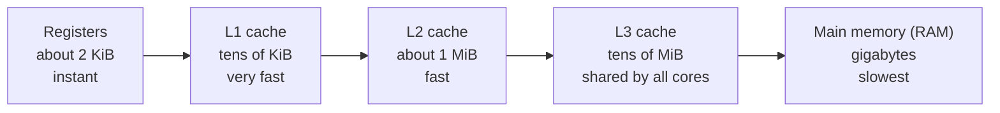
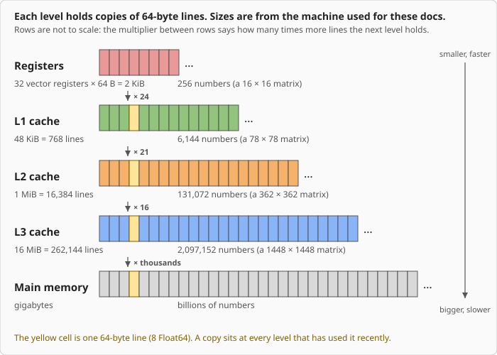
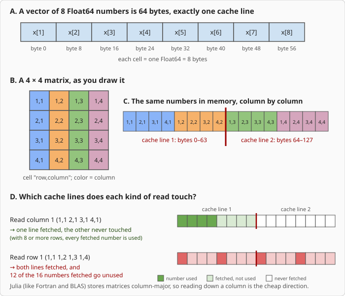
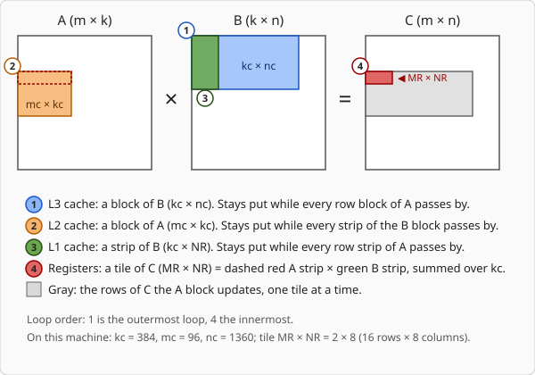
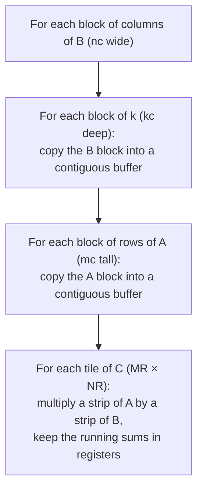

# How a Fast BLAS Works

This page explains why PureBLAS needs to know the sizes of your processor's caches, and what it does
with them. It assumes no background beyond basic arithmetic and a rough idea of what a matrix is. Terms
in italics are defined in the glossary at the end.

## The job

BLAS (Basic Linear Algebra Subprograms) is the library that does the heavy arithmetic behind most
numerical software. Its most important routine is matrix multiplication, `C = A × B`. Multiplying two
1000 × 1000 matrices takes two billion additions and multiplications, so the speed of this one routine
decides how fast simulations, statistics, graphics and machine-learning code run.

The speed depends less on how fast the processor does arithmetic than on how fast numbers reach the
arithmetic units. The rest of this page is about that.

## Memory comes in levels

A processor has a small amount of very fast memory close to the arithmetic units and a large amount of
slower memory farther away. Think of working at a desk: the page in your hand, the books on the desk,
the shelf across the room, the library down the road. Each step holds more and takes longer to reach.

Registers hold the numbers the processor is working on right now. The caches (named L1, L2, L3 for
"level 1" and so on) keep copies of recently used data so that the processor does not have to go all the
way to RAM each time. A number that is already in L1 arrives almost immediately. A number that has to
come from RAM takes longer, and the arithmetic units sit idle while they wait.

The sizes on this page are examples from one machine, a Zen5 processor with AVX-512. Each core has a
48 KiB L1 and a 1 MiB L2, and all cores share a 16 MiB L3. Other processors differ, sometimes by a
factor of two or more at every level. You can see your own with `lscpu` on Linux.

Every level stores the same kind of thing: copies of 64-byte pieces of memory (*cache lines*, explained
below). The figure draws each level as a row of line-sized cells. The levels differ in size and speed.
The figure shows size, and the numbers beside each row show what that means for a matrix of `Float64`:
if nothing else were stored, L1 could hold a 78 × 78 matrix, L2 a 362 × 362 one, and L3 a 1448 × 1448 one.
A larger matrix cannot be held whole at that level, which is why the computation has to be cut into blocks (see below). The cells
in each row are not drawn to scale.

### Data moves in lines, not single numbers

Memory is not fetched one number at a time. The processor loads a *cache line*, typically 64 bytes, which
holds eight `Float64` values side by side. Julia stores matrices *column by column*, so the numbers in a
column sit next to each other and the numbers in a row are far apart.

Reading down a column uses every number in each cache line that was fetched. Reading across a row uses
one number from each line and throws the other seven away. A good *kernel* (the inner loop that does the
arithmetic) reads memory in the order it is stored.

## Why the obvious loop is slow

The textbook way to multiply matrices is three nested loops. To compute one entry of `C`, it walks a
whole row of `A` and a whole column of `B`. It then moves to the next entry and does it again, fetching
nearly all the same numbers a second time.

Count the work for two `n × n` matrices:

- The arithmetic is about `2n³` operations.
- The input data is only `2n²` numbers, plus `n²` for the result.

For `n = 1000` that is two billion operations on three million numbers: each number could be used about
670 times. The textbook loop does not take advantage of that. By the time it needs a number again, the
number has been pushed out of the cache by everything read in between, and it must be fetched from far
away once more.

The [SIMD & Hardware Adaptation](simd.md) page measures the result on one machine, one thread: the
textbook loop, even when the compiler turns it into vector instructions, is 17 to 200 times slower than
PureBLAS. Both execute the same kind of instructions. The difference is how often each number has to be
fetched.

## The fix: work on blocks that fit

Matrix multiplication can be done in any order that adds up the same products. So PureBLAS cuts the
matrices into blocks small enough to stay in the cache, and finishes all the work that touches a block
before moving on. Each block is loaded once and used many times.

Write the product as `C = A × B`, with `A` of size `m × k` and `B` of size `k × n`. The letters `mc`, `kc`
and `nc` are the heights and widths of the pieces, and `MR × NR` is the small tile of `C` that is held in
registers.

There are four nested levels of blocks, one per level of memory:

| Block | Where it lives | Size rule |
|---|---|---|
| Tile of `C`, `MR × NR` vectors | Registers | Enough running sums (16) to keep the multiply-add units busy while each result is in flight, capped by the number of vector registers |
| Strip of `B`, `kc × NR` | L1 | At most half of L1 |
| Block of `A`, `mc × kc` | L2 | At most about 30% of L2 |
| Block of `B`, `kc × nc` | L3 | At most a quarter of L3 |

`MR` counts vectors of rows and `NR` counts columns, so on a machine with 8-number vectors the 2 × 8 tile
in the table below is 16 rows by 8 columns of `C`.

Why those fractions and not the whole cache? The cache must also hold the pieces of `C` and the next
strip of data arriving. If a block filled the whole cache, those arrivals would push out numbers that are
about to be reused. The fractions leave room for them.

The loop structure that produces this is the standard one from the GotoBLAS and BLIS libraries:

The "copy into a contiguous buffer" steps are called *packing*. They rearrange each block so the innermost loop
reads straight through memory with no jumps. Packing costs a little time, which is repaid because every
packed number is then used many times.

## Why the block sizes depend on the machine

Every size above is set by the cache it must fit in, and caches differ between processors. The sizes
PureBLAS computes (for `Float64`) for two processors:

| Processor | L1 / L2 / L3 | Vector width | `MR × NR` | `kc` | `mc` | `nc` |
|---|---|---|---|---|---|---|
| Zen5, the machine used here (AVX-512) | 48 KiB / 1 MiB / 16 MiB | 8 | 2 × 8 | 384 | 96 | 1360 |
| A hypothetical AVX2 part | 32 KiB / 512 KiB / 32 MiB | 4 | 3 × 4 | 512 | 36 | 2044 |

The second row feeds a made-up descriptor to the same formulas to show that different caches give
different answers.

Check the first row against the rules in the table above. The `B` strip is
`kc × NR × 8 bytes = 384 × 8 × 8 = 24 KiB`, half of the 48 KiB L1. The `A` block is
`96 × 384 × 8 bytes = 288 KiB`, which is 28% of the 1 MiB L2. The `B` block is
`384 × 1360 × 8 bytes`, just under 4 MiB and a quarter of the 16 MiB L3. The sizes are rounded down to
whole multiples of the tile, so the fractions are limits that the sizes stay under or at.
For a given matrix, `nc` is an upper limit: the columns are divided into equal blocks no wider than it.

If the sizes are too large, a block no longer fits, data is evicted before it is reused, and the
processor is back to waiting on RAM. If they are too small, the code spends its time on loop overhead and
repacking instead of arithmetic. The best size is slightly under what fits, and where that is depends on
the machine. A library compiled ahead of time has to carry a table of values per processor family.

## What PureBLAS does about it

Julia compiles code on the machine that runs it. PureBLAS uses this to read the cache sizes and vector
width when it is compiled for your machine (the first time it is loaded there) and to compute the block
sizes from the formulas above. There is no table of
per-processor numbers to maintain, and a processor that has never been tested gets sizes derived from its
own caches.

Each tuning constant follows one of three paths, always in this order:

1. If a *Preference* is set for it, that value is used. This lets you override the result by hand.
2. Otherwise, if the best value can be predicted from the detected hardware (like the cache fractions
   above), it is computed by a formula.
3. Otherwise, if it cannot be predicted (for example it depends on how a particular processor schedules
   instructions), PureBLAS times a few candidates on first use and keeps the fastest.

The details are in [Tuning Constants](tuning.md), [SIMD & Hardware Adaptation](simd.md) and the
[Knob Registry](knobs.md). The measured results are on the [Benchmarks](performance.md) page.

## Glossary

| Term | Meaning |
|---|---|
| Cache | Small, fast memory that keeps copies of recently used data |
| Cache line | The unit of transfer between memory levels, typically 64 bytes |
| Register | Storage inside the processor that arithmetic works on directly |
| SIMD | One instruction operating on several numbers at once (a *vector*) |
| Vector width | How many numbers fit in one SIMD register (8 `Float64` for AVX-512) |
| Column-major | Storing a matrix one column after another; Julia does this |
| Blocking | Splitting a computation into pieces that fit in a cache |
| Packing | Copying a block into a buffer laid out for sequential reading |
| Microkernel | The innermost loop, which updates one small tile of `C` in registers |
